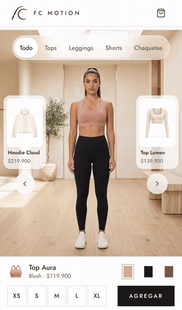

# Portafolio — Juan Sebastián Rincón Farelo

Hoja de vida y portafolio web de una sola página. Desarrollado con **Next.js 16 (App Router, export estático)**, **React 19**, **TypeScript**, **Tailwind CSS v4**, **motion** y componentes adaptados de **React Bits**. Se publica en GitHub Pages con el workflow `.github/workflows/deploy.yml`.



## Estructura del contenido

| # | Sección | Qué muestra |
|---|---------|-------------|
| — | Hero | Credencial 3D con retrato, titular animado, cifras clave y malla de puntos interactiva |
| 00 | Perfil | Quién soy y tres principios de trabajo |
| 01 | **SAED 2.0** | Caso de estudio completo: métricas del repositorio, galería de pantallas, explorador de los 6 roles, mapa de +30 módulos, arquitectura (React → Spring Boot → Oracle VPD) y decisiones de ingeniería |
| 02–03 | **Comercio móvil** | **Baked Bliss Treats (Miga)** y **FC Motion** en marcos de teléfono: tienda del cliente y panel admin de las dueñas lado a lado, video del probador virtual y tira con todas las pantallas |
| 04–07 | Más proyectos | Alexa Beauty, MediTraje, Digitalizador académico IA y Data Warehouse MusicBrainz |
| 08 | Stack | Bento por áreas de conocimiento |
| 09 | Trayectoria | Formación y certificaciones con su PDF oficial |
| 10 | Contacto | Correo, WhatsApp, LinkedIn, GitHub y CV |

## Diseño

- **Paleta pastel** sobre fondo marfil cálido (`#f7f5f0`) y tinta carbón (`#1f1e24`). Siete pasteles de igual luminosidad (pervinca, lila, rosa, durazno, mantequilla, menta y cielo), cada uno con una *tinta* oscura del mismo matiz para texto con contraste AA. Los tokens están al inicio de `src/app/globals.css`.
- Cada proyecto toma un tono afín a su marca: SAED pervinca (su índigo), Miga rosa, FC Motion durazno/oro rosa.
- Tipografías autoalojadas con Fontsource: **Geist** (texto), **Geist Mono** (etiquetas) e **Instrument Serif** (acentos en cursiva).
- Diseño responsive desde 320 px. En móvil los teléfonos se deslizan horizontalmente.
- Respeta `prefers-reduced-motion`: sin animaciones, contadores en su valor final y video en pausa.

## Componentes React Bits (adaptados a TypeScript)

En `src/components/react-bits/`: `BlurText`, `CountUp`, `ScrollVelocity`, `DotGrid`, `ProfileCard`, `SpotlightCard`, `DecryptedText`, `ShinyText` y `Magnet`. Créditos en `THIRD_PARTY_NOTICES.md`.

## Ejecutar en local

```bash
npm install
npm run dev
```

```bash
npm run typecheck && npm run lint && npm run build
```

## Editar contenido

Todo el texto, las capturas y los enlaces viven en **`src/data/portfolio.ts`** (`SAED`, `MOBILE_PROJECTS`, `PROJECTS`, `SKILL_GROUPS`, `EDUCATION`, `CERTIFICATES`, `LINKS`). Las imágenes están en `public/projects/<proyecto>/` en WebP.

## Notas de exactitud

- SAED, Miga y FC Motion tienen repositorio **privado**: se enlaza la demo, no el código.
- Las capturas de Miga y FC Motion se tomaron en **modo demostración** con datos de ejemplo. Las fotos de prenda de FC Motion son provisionales, generadas con IA hasta la sesión oficial.
- Las cifras de SAED (archivos Java, pantallas, migraciones y clases de prueba) se contaron en el repositorio.
- La autorización para iniciar la etapa productiva SENA **no se da por concedida**.

© 2026 Juan Sebastián Rincón Farelo.
